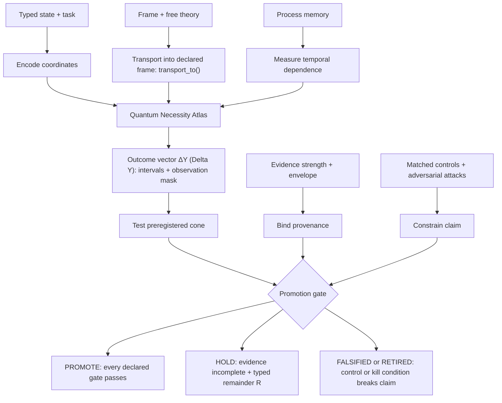
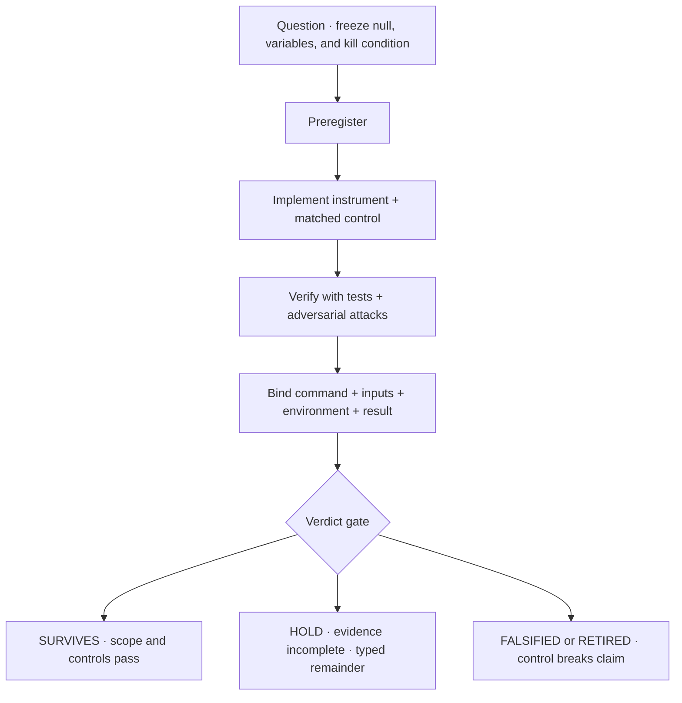
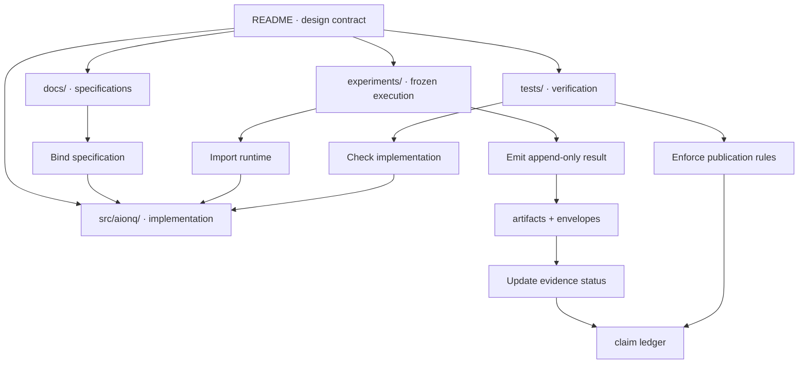

<div align="center">
  <h1>hypercomplexbrain</h1>
  <p><strong>AION-Ω<sup>Q</sup> · QΣ</strong></p>
  <p><strong><span lang="ja">観測 ・ 検証 ・ 余白</span></strong><br>
  observe · verify · leave the remainder visible</p>
  <p>
    A typed research architecture for quantum, geometric, and agentic
    computation—built to survive contact with controls.
  </p>
  <p><code>PYTHON ≥ 3.10 · EVIDENCE P/A/M/H/S/R · FAIL-CLOSED BY DEFAULT</code></p>
</div>

<p align="center">
  <a href="#now">Now</a> ·
  <a href="#map">Map</a> ·
  <a href="#evidence">Evidence</a> ·
  <a href="#run">Run</a> ·
  <a href="#explore">Explore</a> ·
  <a href="#limits">Limits</a>
</p>

> [!IMPORTANT]
> “Brain”, “identity”, “memory”, and “recognition” name software structures,
> state variables, and measurable operators in this repository. They are not
> claims of consciousness, sentience, or AGI.

This repository does not ask whether an architecture *sounds* quantum,
hypercomplex, or cognitive. It asks:

> What is the operator? What is invariant? What is the matched control?
> What would kill the claim—and did the evidence survive?

The core architecture and correction ledger live in
[`docs/ARCHITECTURE.md`](docs/ARCHITECTURE.md). Later bounded rounds have their
own receipts below. This README is the entrance, not a replacement for those
evidence records.

---

<a id="now"></a>

## Now — <span lang="ja">今</span>

The active object is an **evidence-governed research harness**. Quantumness is
not represented by one score; comparisons are typed, frame-aware, and relative
to a declared free theory. Incomplete evidence returns `HOLD` with a typed
remainder instead of silently collapsing to a scalar.

| Surface | Current verdict | Scientific boundary |
|---|---|---|
| **Quantum Necessity Atlas** | **ACTIVE** | Interval-valued, free-theory-relative coordinates; transport is required before comparison. |
| **Moving-frame sheaf instrument · S5/S6** | **SURVIVES, SCOPED** | Safe-cut invariance held on 950/950 adversarial instances; accuracy remained topology-dependent. |
| **Unitary price of hyperbolic depth · QΣ-R6** | **SURVIVES** | Exact algebra plus bounded numerical checks; non-compact transport still incurs a representation cost. |
| **Algebra-valued Fano decoder · S8** | **BOUNDED PASS** | `7 + 21 = 28` coefficients are identifiable in the declared linearized `so(8)` model; no receiver or quantum-advantage claim. |
| **Fractional Quantum Hall probe · S9** | **KILLED PARAMETER POINT** | The corrected frame passed, but `W/Δ = 1.0153…` failed strict bundle isolation; no `C/2` response is authorized. |
| **Causal advantage** | **HOLD** | No result in this checkout connects an architectural coordinate to cognitive performance. |

<details>
<summary><strong>Branch-local continuation: Ohnium and the four-cell organ</strong></summary>

These are pushed research branches, not silently presented as part of this
checkout:

- [`codex/ohnium-observability`](https://github.com/jesusvilela/hypercomplexbrain/tree/codex/ohnium-observability)
  binds a typed Ohnium observability stack at `a8ac895`.
- [`codex/qsigma-r3b-four-cell`](https://github.com/jesusvilela/hypercomplexbrain/tree/codex/qsigma-r3b-four-cell)
  records a synthetic four-cell calibration at `bc707e8`.
  Its registered verdict is **`CALIBRATED_HOLD`**: four outcome axes were
  observed, four remain explicitly unmeasured, and `independent=false`.

Neither branch licenses a cognition, hardware, or quantum-advantage claim.

</details>

> **<span lang="ja">余白</span> / yohaku.** Blank space is not evidence. Here, unresolved structure
> remains visible as a typed `[R]` rather than being filled by rhetoric.

---

<a id="map"></a>

## Map — <span lang="ja">地図</span>

The architecture is a set of coupled measurement surfaces, not a linear
“input → intelligence” pipeline.



In plain language: state, frame, free theory, and memory remain distinct inputs;
the Atlas emits a vector with uncertainty and missingness; promotion occurs only
when the preregistered region, matched controls, and evidence gates all pass.
Incomplete evidence returns `HOLD` plus typed remainder `[R]`; a failed control
or kill condition falsifies or retires the claim.

Four invariants keep the map scientific:

1. **Type before arithmetic.** Bits, strengths, costs, and residuals cannot be
   compared merely because each is encoded as a float.
2. **Transport before comparison.** A section measured over one free theory
   cannot be ordered against another until a transport declares what is
   preserved, transformed, or lost.
3. **Whole eigenspaces before arbitrary cuts.** Degenerate spectral boundaries
   extend to the next real gap; fixed cuts were falsified by the S6 sweep.
4. **Cone before score.** Advantage is a preregistered region over outcomes,
   not a weighted scalar that can hide a failed dimension.

<details>
<summary><strong>The four corrections that define this architecture</strong></summary>

| Revision | What broke | What replaced it |
|---|---|---|
| **I · notation** | Counting unitary-labelled edges returned `1.0000` for every all-unitary core. | Simulation-cost intervals with explicit lower/upper semantics. |
| **II · scalar** | `Q_cert` repeated the same compression; even `H T T† H = I` scored `0.4568`. | An eight-coordinate Quantum Necessity Atlas. |
| **III · geometry** | The live free-theory diamond measured `δ / diameter = 0.5`, the maximal metric-space value; the claimed Poincaré base was not earned. | A containment graph with no curvature assigned until a conversion metric is measured. |
| **IV · transport** | In the implemented A-tier transport surrogate, carrying a lossy summary section around a free-theory loop produced defect `∞`, while the underlying state loop returned with defect `0.0`. | State transport and section transport are modeled separately; neither module-local result is promoted to a universal theorem. |

Corrections are versioned and preserved. A failed instrument is part of the
research record, not something the prose edits away.

</details>

<details>
<summary><strong>What remains operational after the corrections</strong></summary>

- Coherentization changed the measured residency by only **5.2% of the
  advertised gain**, while spending additional magic.
- Bordón respiration is modeled as reservoir dynamics:
  `drone_ceiling = refill_rate`; buffer capacity cannot fund a permanently
  uninterrupted channel.
- Entanglement is not a universal quantumness coordinate and is
  frame-dependent.
- The Fibonacci fusion implementation satisfies pentagon and hexagon checks to
  numerical precision while retaining an order-sensitive associator.
- `rank(G)` measures a holonomy span. Robustness additionally requires
  effective rank and conditioning.
- Syndrome extraction defeats the former blanket prohibition on
  self-tomography: the tested protected logical state retained fidelity
  `1.000000`.

Each statement is scoped in
[`docs/ARCHITECTURE.md`](docs/ARCHITECTURE.md) and
[`docs/SOURCES_DIGEST.md`](docs/SOURCES_DIGEST.md).

</details>

---

<a id="evidence"></a>

## Evidence — <span lang="ja">証</span>

New P/A/M promotions are required to move through a fail-closed transaction.
This diagram shows that evidence transaction—not the topology of the whole
architecture. Coverage is not retroactive: the architecture ledger currently
records **48 of 81** earlier claims without an evidence envelope.



Text equivalent: freeze the question before the result, implement both target
and control, attack the instrument, bind provenance, then report `SURVIVES`,
`HOLD`, or `RETIRED`. An envelope proves provenance; it does not manufacture an
independent witness.

### The evidence alphabet

| Tag | Meaning | Publication rule |
|---:|---|---|
| **P** | Proved or exactly computed under explicit assumptions | Cite only the exact formal statement. |
| **A** | Axiomatized or checked through a weaker surrogate | Name the surrogate and the gap to the external claim. |
| **M** | Measured | Report sample size, interval, null, instrument, and scope. |
| **H** | Hypothesis | Requires preregistration and a kill condition. |
| **S** | Semantic design object | May guide implementation; cannot inherit theorem status. |
| **R** | Retired | Preserve the correction; never cite it as a live result. |

### Research ledger

| Round | Finding and scientific boundary | Receipt |
|---|---|---|
| **S3** | **Hidden-cycle localization survived its original matched controls.** S4 later showed it was basis-relative; the original headline is superseded. | [`ARCHITECTURE.md`](docs/ARCHITECTURE.md) |
| **S4-G100** | **The recognition chamber failed 6/10 gates.** Apparent gains tracked the budget/search-space ratio. | [`S4_G100_RESULTS.md`](docs/S4_G100_RESULTS.md) |
| **S5/S6** | **Safe-cut moving-frame invariance held for 950/950 cases.** Accuracy advantage is not uniform across graph families. | [`ARCHITECTURE.md`](docs/ARCHITECTURE.md) |
| **S7** | **The external P≠NP / holonomy / `H¹` chain did not survive recomputation.** Curvature, global holonomy, and arbitrary sheaf `H¹` are not one biconditional. | [`MANIFOLD_REFERENCE.md`](docs/MANIFOLD_REFERENCE.md) |
| **QΣ-R6** | **Four frozen hyperbolic-cost predictions survived.** This is exact representation theory plus bounded simulation, not demonstrated hardware advantage. | [`QUANTUM_SUBSTRATE_COST.md`](docs/QUANTUM_SUBSTRATE_COST.md) |
| **S8** | **Algebra-valued crosstalk passed the `7/21/28` gates.** The result is limited to the linearized compact `so(8)` model; its comparative rank claim was corrected. | [`S8_FANO_DECODER.md`](docs/S8_FANO_DECODER.md) |
| **S9** | **The frozen finite Hofstadter point was killed.** Strict isolation failed; raw coarse `C = 1` remains telemetry only. | [`S9_FQHE_PROBE.md`](docs/S9_FQHE_PROBE.md) |

<details>
<summary><strong>S7 degree correction: curvature is not arbitrary sheaf H¹</strong></summary>

The source archive linked non-trivial holonomy, non-trivial curvature, and a
non-trivial `H¹` class as if they were equivalent. The repository records the
correction:

- Ambrose–Singer concerns the holonomy **Lie algebra**, hence the identity
  component under its hypotheses.
- A curvature obstruction such as a first Chern class is degree two.
- A graph nerve is one-dimensional: curvature two-forms vanish there while
  flat global monodromy can remain non-trivial.
- For the tested cellular sheaf,
  `dim H¹ = dim H⁰ + (b₁ − 1)d`; its magnitude is therefore not an obstruction
  score.

Non-zero curvature does force non-trivial holonomy in the relevant
differential-geometric setting. The reverse implication fails in general.

</details>

<details>
<summary><strong>S8 control correction: rank was not the unique Fano advantage</strong></summary>

The Fano basis passes the declared local decoder gates:

```text
rank(S)       = 7
rank(C)       = 21
rank([S C])   = 28
cond([S C])   = 2.44949
```

But in 1,000 random-support controls,
`rank(C) = choose(rank(S), 2)` and
`rank([S C]) = rank(S) + rank(C)` had no observed mismatch. Full crosstalk rank
was confounded with full signal rank. The design-specific conditioning
separation was post-hoc and remains unpromoted pending preregistered
replication.

</details>

---

<a id="run"></a>

## Run — <span lang="ja">実行</span>

### Quiet path

```bash
python -m venv .venv

# Windows PowerShell
.\.venv\Scripts\python.exe -m pip install -e ".[dev]"
.\.venv\Scripts\python.exe -m pytest -q
.\.venv\Scripts\python.exe experiments/run_audit.py

# macOS / Linux
.venv/bin/python -m pip install -e ".[dev]"
.venv/bin/python -m pytest -q
.venv/bin/python experiments/run_audit.py
```

Run the three commands for your platform; the two paths are alternatives.

`pytest` is the current census. The README intentionally does not freeze a
repository-wide test count while concurrent research rounds are moving.

> [!CAUTION]
> Some experiment producers are append-once and bind results to a frozen
> manifest and implementation commit. Read the round document before rerunning
> a producer; a refusal to overwrite evidence is expected behavior.

<details>
<summary><strong>Experiment routes</strong></summary>

| Surface | Command | What it tests |
|---|---|---|
| Core audit | `python experiments/run_audit.py` | Atlas, transport, fusion, identity, budgets, and correction contracts |
| Falsification sweep | `python experiments/acaf_sweep.py` | 150-core representation and cancellation attacks |
| Visibility | `python experiments/run_visibility.py` | Coupling field against code distance |
| Replication | `python experiments/run_replication.py` | Depth, intervals, and distributions |
| Sentinel · S1 | `python experiments/run_sentinel.py` | Sparse-gap novelty claim and kill condition |
| Stokes router · S2 | `python experiments/run_stokes.py` | Braid action and basis mutation |
| Sheaf · S3 | `python experiments/run_sheaf.py` | Obstruction localization and matched controls |
| Recognition · S4 | `python experiments/run_s4_g100.py` | Ten preregistered chamber gates |
| Basis attack · S4 | `python experiments/run_s4_basis_attack.py` | Frame dependence of the S3 instrument |
| Moving frame · S5 | `python experiments/run_moving_frame.py` | Orbit-collapse versus orbit-resolution |
| ACAF frame sweep · S6 | `python experiments/run_acaf_frame_sweep.py` | Degenerate-cut adversarial search |
| Audit adjudication · S7 | `python experiments/run_audit_adjudication.py` | Recompute external corrections |
| Hyperbolic unitary price · QΣ-R6 | `python experiments/run_hyperbolic_qubit_cost.py` | Compact/non-compact representation cost |
| Fano decoder · S8 | `python experiments/run_fano_decoder.py` | Algebra-valued local identifiability |

For S9, use the exact frozen commands and correction protocol in
[`docs/S9_FQHE_PROBE.md`](docs/S9_FQHE_PROBE.md).

</details>

<details>
<summary><strong>Verification membrane</strong></summary>

```bash
python -m aionq.verify_envelopes artifacts
```

With a source checkout rather than an installed package:

```bash
PYTHONPATH=src python -m aionq.verify_envelopes artifacts
```

The verifier checks artifact digests, effective input counts, environment
differences, commit bindings, and witness status. A valid first-party envelope
still reports `independent=false`.

</details>

---

<a id="explore"></a>

## Explore — <span lang="ja">探索</span>

| Enter through | Read | Use it for |
|---|---|---|
| **Architecture** | [`ARCHITECTURE.md`](docs/ARCHITECTURE.md) | Full correction ledger, operators, phased programme |
| **Evidence** | [`SOURCES_DIGEST.md`](docs/SOURCES_DIGEST.md) | Provenance, transferred claims, exclusions |
| **Mathematics** | [`MANIFOLD_REFERENCE.md`](docs/MANIFOLD_REFERENCE.md) | Condensed formal objects and degree corrections |
| **Reproducibility** | [`WITNESS_WEAVE.md`](docs/WITNESS_WEAVE.md) | Append-only witness scheduling and authority boundaries |
| **Quantum substrate** | [`QUANTUM_SUBSTRATE_COST.md`](docs/QUANTUM_SUBSTRATE_COST.md) | `SL(2,R)` / `SO(2,2)` unitary-cost analysis |
| **Decoder** | [`S8_FANO_DECODER.md`](docs/S8_FANO_DECODER.md) | Algebra-valued `so(8)` signal/crosstalk slice |
| **FQH probe** | [`S9_FQHE_PROBE.md`](docs/S9_FQHE_PROBE.md) | Controls-first finite Hofstadter experiment |
| **External audit** | [`EXTERNAL_WITNESS.md`](docs/EXTERNAL_WITNESS.md) | What an external verdict can and cannot establish |

### Repository topology



Text equivalent: documents specify the operators; `src/aionq` implements them;
experiments execute frozen questions; tests attack both implementation and
claims; artifacts bind results back into the evidence ledger.

<details>
<summary><strong>Module atlas</strong></summary>

```text
src/aionq/
  atlas.py             typed Quantum Necessity Atlas
  advantage.py         vector-valued promotion cone
  stack.py             typed quantities + transport holonomy
  residency.py         simulation-cost interval
  coherentize.py       Stinespring coherentization audit
  budget.py            coherence and magic budgets
  bordon.py            reservoir respiration + drone ceiling
  process.py           temporal-memory instruments
  fusion.py            Fibonacci fusion grammar
  identity.py          polyholonomic identity + Gram checks
  selfknowledge.py     self-knowledge bounds + syndrome counterexample
  qrf.py               quantum reference frames
  quantities.py        typed units, uncertainty, base relativity
  governance.py        executable P/A/M/H/S/R evidence lattice
  evidence.py          provenance envelopes
  sheaf.py             cellular sheaf instruments
  movingframe.py       group actions + orbit audit
  interference.py      cycle-obstruction query oracle
  fano_decoder.py      algebra-valued S8 decoder
  fqhe.py              controls-first S9 Hofstadter probe
  witness*.py          reproducibility membrane + witness weave
  recognition/         bounded S4 recognition chamber

manifests/              preregistrations and correction protocols
experiments/            frozen runners and adversarial sweeps
artifacts/              result payloads and evidence envelopes
tests/                  executable claim and regression gates
docs/                   derivations, ledgers, limitations, handoffs
```

</details>

---

<a id="limits"></a>

## Limits — <span lang="ja">境界</span>

| This repository can establish | This repository does not establish |
|---|---|
| Whether encoded operators satisfy their declared algebraic contracts | Consciousness, sentience, subjectivity, or AGI |
| Whether a numerical instrument survives its frozen controls and attacks | Quantum advantage from notation or simulator-only separation |
| Whether a result artifact is bound to named code, inputs, and environment | Independent replication merely because an envelope verifies |
| Whether a representation is invariant under the implemented group action | Invariance under transformations that were never modeled |
| Whether one finite parameter point passes a preregistered gate | A thermodynamic phase, hardware behavior, or universal scaling law |
| Whether the implemented P/A/M/H/S/R publication policy is followed | A proof of `P = NP`, `P ≠ NP`, or a bridge from either statement to cognition |

`q_sim_upper` remains an upper bound supplied by the implemented classical
simulation portfolio. Better classical algorithms may lower it. The containment
base has no assigned geometry until a real free-conversion metric exists. The
advantage cone is ready to receive evidence; it is not itself evidence.

> **Scientific posture:** preserve the failed run, preserve the null, preserve
> the frame, preserve the remainder. Promotion is the last operation—not the
> first sentence.

---

<div align="center">
  <p><strong><span lang="ja">静かな系、厳しい証拠。</span></strong><br>
  a quiet system · strict evidence</p>
  <p>Research software · no consciousness claim · no AGI claim · no completed complexity proof</p>
</div>
