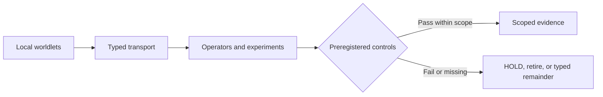

<div align="center">
  <h1>HypercomplexBrain</h1>
  <p><strong>AION-Ω<sup>Q</sup> · QΣ</strong></p>
  <p><strong>What survives when the representation changes?</strong></p>
  <p>A public research laboratory for geometric, quantum, hypercomplex, and agentic computation.</p>
  <p><em>Observe · Verify · Leave the remainder visible.</em></p>
</div>

> [!IMPORTANT]
> **This is a research architecture, not a claim to have built a conscious brain.**
> “Brain”, “identity”, “memory”, and “recognition” name models and operators, not
> evidence of sentience, human-like cognition, AGI, biological fidelity, or
> quantum advantage. The strongest claims remain local to their stated models,
> assumptions, tests, and controls.

## The question

Different models can inhabit different geometries, keep different clocks,
observe different quantities, and make different distinctions. Sometimes
putting everything into one vector, one frame, or one score is useful. Sometimes
it destroys precisely the structure we wanted to understand.

AION asks whether these **local worlds can communicate without being flattened
into one world**. It explores what survives translation, what changes, and what
cannot be recovered. Its mathematical vocabulary is deliberately ambitious; its
evidence rules are deliberately less forgiving.

The project is both an *architectural hypothesis* and a collection of
*executable research instruments*. Neither a compelling picture nor a passing
test is allowed to quietly become a theorem about cognition.

## A small map

| Research surface | The concrete question | Start here |
|---|---|---|
| **Worldlets** | What does one local model know, and under which metric, algebra, clock, and resource constraints? | [HB-0 polycosmic kernel](docs/HB0_POLYCOSMIC_KERNEL.md) |
| **Tendrils and remainders** | What is preserved, transformed, lost, or paid for when moving between models? | [HB-0 transport contracts](docs/HB0_POLYCOSMIC_KERNEL.md) |
| **Geometric and quantum operators** | Which invariants survive frame changes, resource controls, and representation changes? | [Architecture and corrections](docs/ARCHITECTURE.md) |
| **Quantum Necessity Atlas** | Can we describe requirements and limitations without compressing everything into a misleading “quantumness” score? | [Architecture and corrections](docs/ARCHITECTURE.md) |
| **Evidence governance** | What can a proof, surrogate, finite experiment, or negative result legitimately establish? | [Source digest](docs/SOURCES_DIGEST.md) |

The implemented HB-0 reference architecture contains 32 Worldlets in four
identity regimes. Its shared Poincaré base is a **declared, A-tagged coordinate
contract**, not evidence that an underlying graph has earned negative curvature.
Local fibers remain heterogeneous; tangent-matched Euclidean controls matter.
Worldlets and Tendrils are software objects with measured defects, **not**
automatically mathematical sheaves, functors, or a theory of personal identity.

The diagram below shows the **research loop**, not the anatomy of an artificial
brain:



What matters is not merely whether something works in its chosen frame, but
**whether its meaning survives a change of frame and a meaningful control**.

## What the experiments say (and do not say)

These are repository-reported outcomes at their **documented, bounded scope**.
They are not claims of fresh independent reproduction.

| Research thread | Recorded outcome | Boundary worth remembering |
|---|---|---|
| **HB-0 polycosmic kernel** | Executable typed architecture and falsification tests | No preregistered, held-out competence gain has been demonstrated. [Read](docs/HB0_POLYCOSMIC_KERNEL.md) |
| **S4 recognition chamber** | Failed 6 of 10 preregistered gates | Search-space/budget effects defeated the original interpretation. [Read](docs/S4_G100_RESULTS.md) |
| **S5/S6 moving frames** | Safe-cut invariance reported on 950/950 adversarial instances | Accuracy remained graph-topology-dependent. [Read](docs/ARCHITECTURE.md) |
| **QΣ-R6 hyperbolic cost** | Exact representation arguments and bounded numerical checks | Not a demonstrated physical-device or quantum advantage. [Read](docs/QUANTUM_SUBSTRATE_COST.md) |
| **S8 Fano decoder** | Local identifiability in a linearized `so(8)` model | The rank comparison had a control confound; no full communications receiver was established. [Read](docs/S8_FANO_DECODER.md) |
| **S9 finite Hofstadter probe** | **Parameter point killed** after a frame repair | Strict bundle isolation failed; no `C/2` response is authorized. [Read](docs/S9_FQHE_PROBE.md) |
| **QΣ-R6k equal-resource retrieval** | Angular gain without radial gain in one frozen finite-grid protocol | No claim that the radial channel was repaired or that cognitive advantage follows. [Read](docs/QSIGMA_R6K_EQUAL_RESOURCE_RESERVOIR.md) |

Some negative results are more informative than positive-looking dashboards.
We keep failed hypotheses, superseded interpretations, and adversarial controls
because they narrow the terrain that remains worth exploring.

## How a claim earns its status

AION uses **P / A / M / H / S / R** as *kinds of evidence*, not a single
confidence score.

| Tag | Meaning | What the reader should demand |
|---|---|---|
| **P** | Proved or exactly computed under stated assumptions | Exact statement, hypotheses, and proof boundary |
| **A** | Axiom or weaker verified surrogate | The missing bridge to the stronger claim |
| **M** | Bounded measurement | Instrument, null, sample, environment, and uncertainty |
| **H** | Open, falsifiable hypothesis | Preregistration and kill condition |
| **S** | Semantic or architectural model | No automatic promotion to empirical fact or theorem |
| **R** | Retired or superseded claim | Preserved correction and source trail |

The evidence tag **R** (retired) is distinct from a **typed `[R]` remainder**
(e.g. transport loss or unresolved coherence). The latter records something
that still needs interpretation or reconstruction; it is not a failure
percentage or a universal obstruction.

A locally valid test, a checksum-valid first-party artifact, and an
**independently reproduced result are three different things**. The
[verification and witness protocol](docs/WITNESS_WEAVE.md) keeps them apart.

## Explore or reproduce

**If you are new to the ideas:** read this page, then the
[HB-0 kernel](docs/HB0_POLYCOSMIC_KERNEL.md). The
[mathematical reference](docs/MANIFOLD_REFERENCE.md) explains several familiar
analogues and the places where the analogies stop.

**If you want to challenge a claim:** follow the
[architecture/correction ledger](docs/ARCHITECTURE.md), inspect the
[original evidence limitations](docs/SOURCES_DIGEST.md), then choose a
[falsified experiment](docs/S9_FQHE_PROBE.md) or a
[bounded survivor](docs/S8_FANO_DECODER.md).

**If you want to run the code:** the Python package is `aionq` (Python 3.10+
with NumPy, SciPy, and Qiskit). Clone this public repository:

```bash
git clone https://github.com/Dojo-1/hypercomplexbrain.git
cd hypercomplexbrain
python -m venv .venv
```

Then choose **one** of the following platform-specific paths.

macOS / Linux:

```bash
.venv/bin/python -m pip install -e ".[dev]"
.venv/bin/python -m pytest -q
.venv/bin/python experiments/run_audit.py
```

Windows PowerShell:

```powershell
.\.venv\Scripts\python.exe -m pip install -e ".[dev]"
.\.venv\Scripts\python.exe -m pytest -q
.\.venv\Scripts\python.exe experiments/run_audit.py
```

The test suite checks implemented contracts; it is **not** a proof of all
scientific interpretations. Some experiment producers are append-once and
bound to frozen manifests. Read the relevant experiment document before
rerunning a producer or trying to overwrite its results. First-party evidence
can be checked with `python -m aionq.verify_envelopes artifacts`.

### Where the work lives

| Directory | Purpose |
|---|---|
| [`src/aionq/`](src/aionq/) | Implemented operators, types, transports, and governance |
| [`experiments/`](experiments/) | Experiment runners and adversarial attacks |
| [`manifests/`](manifests/) | Preregistrations, parameter freezes, and decision contracts |
| [`artifacts/`](artifacts/) | Results, evidence envelopes, and correction trails |
| [`tests/`](tests/) | Executable contracts and regression tests |
| [`formal/`](formal/) | Formal source and explicit verification limits |
| [`docs/`](docs/) | Derivations, interpretation, failures, and research handoffs |

Two useful additional windows are
[Ohnium's carrier-change observatory](docs/OHNIUM_V2_OBSERVABLE_ASCENT.md)
and the [four-cell calibration contract](docs/QSIGMA_R3B_FOUR_CELL.md). Their
status belongs to their documents; neither is a cognition breakthrough.

## An invitation, not a conclusion

This work is being opened to other readers and investigators. A precise
counterexample, a cleaner operator, a matched null, a reproduction attempt, a
missing hypothesis, or a simpler exposition can all make the research better.

If you open an issue or pull request, please identify the **claim or operator**,
its **assumptions**, the **evidence you inspected**, and a **test or example**
that could distinguish your interpretation from the current one. You do not
need to share the project's vocabulary to challenge its mathematics.

A separate 78-page *Human Guide, publisher-review edition v2.0* was prepared
on 28 August 2026 against commit `fbf7b9b`. It is a historical explanatory
snapshot, **not** an independent peer review and **not** the current code
authority. The committed sources and evidence artifacts take precedence.

This repository is public, but no `LICENSE` file is currently included; public
visibility alone does not grant general reuse rights. AI assistance has been
used in this research; its outputs are not substitutes for independent review.

**Observe. Verify. Leave the remainder visible.**

<div align="center">
  <sub>Dojo-1 · Research software · Open questions welcome</sub>
</div>
