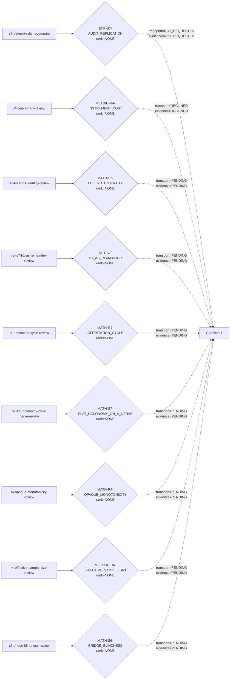

# Witness weave: `godelian-review-v1`

This view is generated from the append-only journal and current evidence envelopes. Dashed edges are transport-only states and carry no evidence.

| Task | Claim | Requested | Transport state | Applied evidence | Evidence rank | Handle reference |
|---|---|---:|---|---|---|---|
| `s7-deterministic-recompute` | `EXP-S7-AUDIT_REPLICATION` | recomputed | not_requested | not_requested | NONE | `-` |
| `r4-benchmark-review` | `METRIC-R4-INSTRUMENT_COST` | reviewed | declined | declined | NONE | `-` |
| `s7-euler-h1-identity-review` | `MATH-S7-EULER_H1_IDENTITY` | reviewed | pending | pending | NONE | `sha256:8e83b6b959be38fb50150234499d066e4c2a9f0d7a2edf8c1945bb4c1b0e12e2` |
| `ret-s7-h1-as-remainder-review` | `RET-S7-H1_AS_REMAINDER` | reviewed | pending | pending | NONE | `sha256:acab585b025c7cbed02dac6cdeea5812efdea3de5d714fb3c5fa0d2a04620b22` |
| `r4-attestation-cycle-review` | `MATH-R4-ATTESTATION_CYCLE` | reviewed | pending | pending | NONE | `sha256:80c89aa36bb110339bd13bace2285fc148678918cf64a58b5ebf45b55ad1bf08` |
| `s7-flat-holonomy-on-a-nerve-review` | `MATH-S7-FLAT_HOLONOMY_ON_A_NERVE` | reviewed | pending | pending | NONE | `sha256:a80777295d139190d2fab8a6ffec692cf6d2ebf6a96d11081c8c0e87908baac2` |
| `r4-opaque-monotonicity-review` | `MATH-R4-OPAQUE_MONOTONICITY` | reviewed | pending | pending | NONE | `sha256:baf444dc5959d819fb1b6a6c45eca17acf06581437b83c23d291f8931046c04e` |
| `r4-effective-sample-size-review` | `METHOD-R4-EFFECTIVE_SAMPLE_SIZE` | reviewed | pending | pending | NONE | `sha256:7eb8336dba2a860aac61e57f3680c90825830514fb83827487c924886e27be5f` |
| `s6-bridge-blindness-review` | `MATH-S6-BRIDGE_BLINDNESS` | reviewed | pending | pending | NONE | `sha256:4a688db029ee8870b5ebbfd41cb5f9c8f0fbba9fe456e06dbbc7ab66a3a2845c` |

## Reading rule

`PENDING`, `DECLINED`, and `NOT_REQUESTED` remain rank `NONE`. Attestations are bounded at `ATTESTED`; reviews reach `REVIEWED`; only a matching recomputation of comparable deterministic artifacts reaches `INDEPENDENT`. Ranks are maxima of direct acts, never sums over parties.
