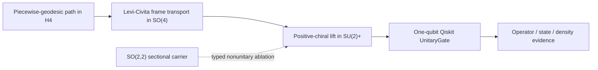

# HB0-QB2 · Chiral Spin Connection over \(H^4\)

## Result

QB2 adds a compact quantum fiber to the universal Poincaré \(H^4\) base without
turning the noncompact base into a finite-dimensional quantum gate.



The implemented object is

\[
\text{path in }H^4
\longmapsto
U_{\mathrm{path}}\in SU(2)_+.
\]

It is a spin-bundle holonomy. It is **not** a finite-dimensional unitary
representation of the noncompact isometry group
\(\operatorname{SO}^+(4,1)\).

## Exact positive-chiral connection

In oriented Poincaré coordinates \(x\in B^4\), with curvature radius \(R\),

\[
e^a=\frac{2R}{1-\lVert x\rVert^2}dx^a.
\]

Let the self-dual 't Hooft symbols obey

\[
\eta^i{}_{jk}=\epsilon_{ijk},
\qquad
\eta^i{}_{j4}=\delta_{ij},
\qquad
T_i=-\frac{i}{2}\sigma_i.
\]

The positive-chiral Levi-Civita connection and curvature are

\[
A^i_\mu(x)
=-\frac{2}{1-\lVert x\rVert^2}
  \eta^i{}_{\mu\nu}x^\nu,
\]

\[
F^i_{\mu\nu}(x)
=\frac{4}{(1-\lVert x\rVert^2)^2}
  \eta^i{}_{\mu\nu}.
\]

In an orthonormal frame,

\[
F^i_{ab}=\frac{1}{R^2}\eta^i{}_{ab}.
\]

The six tangent two-planes therefore span exactly three \(su(2)_+\) curvature
directions. The negative-chiral \(SU(2)_-\) factor remains the explicit
`[R]_negative_chirality` remainder.

## Closed-form geodesic accelerator

For the unique \(H^4\) geodesic \(p\rightarrow q\), define

\[
w=1-p\cdot q,
\qquad
b_i=\eta^i{}_{\mu\nu}q^\mu p^\nu,
\qquad
s=\sqrt{w^2+\lVert b\rVert^2}.
\]

Then the continuously signed spin link is

\[
\boxed{
U_+(q\leftarrow p)
=\frac{wI-i b_i\sigma_i}{s}
}.
\]

Because \(p,q\) are strictly inside the unit ball, \(w>0\). This fixes the
continuous lift without a matrix logarithm, ODE integrator, or arbitrary
global-phase repair.

The implementation checks every link independently against the repository's
existing hyperboloid Levi-Civita transporter. The canonical ambient tetrad is

\[
E_a(x)=
\left(
\frac{2x_a}{1-\lVert x\rVert^2},
\ e_a+\frac{2x_ax}{1-\lVert x\rVert^2}
\right).
\]

Columnwise parallel transport gives \(Q\in SO(4)\). Its self-dual adjoint

\[
R^+_{ij}(Q)
=\frac14\langle\eta_i,Q\eta_jQ^T\rangle_F
\]

must agree with the Bloch adjoint

\[
R_{ij}(U)
=\frac12\operatorname{Tr}
  \left(\sigma_iU\sigma_jU^\dagger\right).
\]

This is the primary factor-of-two, orientation, and sign control.

## Path ordering and the central sign

For links \(U_k:p_k\rightarrow p_{k+1}\),

\[
U_{\mathrm{path}}
=U_{n-1}\cdots U_1U_0.
\]

QB2 retains this signed matrix. Density conjugation alone is insufficient:

\[
\rho\mapsto U\rho U^\dagger
\]

identifies \(U\) and \(-U\). A controlled-\(-I\) Qiskit interferometric control
keeps the central Spin lift observable even though an uncontrolled one-qubit
density cannot see it.

Open-path matrices depend on the declared tetrad gauge. Closed-loop conjugacy
data, including the signed half trace, are the appropriate gauge-covariant
holonomy observations.

## Exact curvature witness

For the geodesic triangle

\[
0\rightarrow\epsilon e_1\rightarrow\epsilon e_2\rightarrow0,
\]

\[
U_\triangle
=\exp[-2\arctan(\epsilon^2)T_3],
\]

\[
\operatorname{Area}_{H^4}
=2R^2\arctan(\epsilon^2),
\qquad
\theta_{\mathrm{spin}}
=-\frac{\operatorname{Area}_{H^4}}{R^2}.
\]

The origin-tangent-matched flat \(\mathbb R^4\) connection has identity loop
holonomy.

For a \(+x\) qubit density,

\[
D_{\mathrm{tr}}
=\frac{\epsilon^2}{\sqrt{1+\epsilon^4}},
\qquad
F_{\mathrm{root}}
=\frac{1}{\sqrt{1+\epsilon^4}}.
\]

A \(\sigma_3\)-aligned density is unchanged. This blind probe is retained as a
control against treating one state observation as the holonomy.

## QB1 and QB2 remain different objects

QB1 encodes one base point as a radial-flag qutrit:

\[
\rho_x
=(1-r)|f\rangle\langle f|
\oplus r|z\rangle\langle z|.
\]

QB2 transports an independent spin-fiber datum. It may lift
\(U\in SU(2)\) algebraically as

\[
\widetilde U=\operatorname{diag}(1,U)
\]

to preserve QB1's radial flag, but the transported qutrit is not silently
identified with QB1's separately defined canonical encoding of the endpoint.
The full \(3\times3\) QB1 state is not one qubit.

## Sectional accelerator boundary

The implementation audited
[`jesusvilela/nnn-hyperbolic-ramdisk_v2`](https://github.com/jesusvilela/nnn-hyperbolic-ramdisk_v2)
at commit
[`0dbc6f9`](https://github.com/jesusvilela/nnn-hyperbolic-ramdisk_v2/commit/0dbc6f9d138229d9d40b86a8e504516815139843).
No runtime dependency or storage service was imported.

| Sectional operator | QB2 carrier | Status |
|---|---|---|
| Strict Möbius addition | \(H^4\) base | Implemented without clipping |
| 100-section geodesic refinement | \(H^4\rightarrow SU(2)_+\) | Signed composition control |
| Normalized four-lane Hadamard | Real amplitude control | Orthogonal ablation |
| \(iH\) | One-qubit fiber | Valid \(SU(2)\) gauge/amplitude control |
| Fixed phase \(1.2368\) | One-qubit fiber | Algebraic gauge control; deliberately excluded from the geometric-path Qiskit API |
| \(SO(2,2)\) boost | Split-signature carrier | Preserves \(Q_{2,2}\), rejected as a qubit gate |
| Jitter \(0.19685006\) | Undefined | Inert metadata |
| Perlin seed `0b62c6dd` | Undefined | Inert metadata |
| “Spectral gap at H(100)” | Undefined Hamiltonian | Not claimed |

The 100-section check is exact path-refinement invariance. It is not an
adiabatic-theorem or spectral-gap result.

The carrier separation is structural:

\[
\operatorname{Spin}(2,2)
\simeq SL(2,\mathbb R)\times SL(2,\mathbb R)
\]

is not

\[
\operatorname{Spin}(4)
\simeq SU(2)_+\times SU(2)_-.
\]

The former supplies a noncompact substrate ablation. The latter supplies the
compact chiral qubit fiber.

The external repository's Hadamard mixing can leave its \(Q=1\) pseudo-sphere,
its Möbius helpers clip at a fixed epsilon, and its current reservoir backends
do not establish durable append-only storage. QB2 therefore reuses operator
patterns and pinned provenance, not those runtime claims.

## Qiskit projection

Qiskit receives a validated `SpinPathReport` or adjacent `ChiralSpinLink`
objects through
[`UnitaryGate`](https://quantum.cloud.ibm.com/docs/en/api/qiskit/qiskit.circuit.library.UnitaryGate).
Detached \(SU(2)\) matrices—including otherwise valid gauge gates—are refused:
the circuit receipt remains bound to the universal base, path endpoints, and
ordered geometric links. Qiskit does not derive or repair the connection.

The simulator-only projection checks:

- direct matrix equality with
  [`Operator`](https://quantum.cloud.ibm.com/docs/en/api/qiskit/qiskit.quantum_info.Operator);
- amplitude equality with
  [`Statevector`](https://quantum.cloud.ibm.com/docs/en/api/qiskit/qiskit.quantum_info.Statevector);
- density intertwining with
  [`DensityMatrix`](https://quantum.cloud.ibm.com/docs/en/api/qiskit/qiskit.quantum_info.DensityMatrix).

`Operator.equiv()` is deliberately not used because it ignores global phase
and would erase the \(+I/-I\) lift distinction.

The report fixes:

```text
simulator_only  = true
backend_executed = false
advantage_claim  = false
```

The repository currently declares Qiskit as a core dependency. The lazy import
in QB2 is a defensive typed failure boundary, not a claim that the complete
package works without Qiskit.

## Evidence ceiling

QB2 establishes exact and float64-checked identities for this declared
connection, its controls, and its local Qiskit circuit projection.

It does not establish:

- a unitary realization of noncompact hyperbolic translations;
- a physical quantum device or noise model;
- storage durability or locality;
- quantum capacity, runtime advantage, or scaling advantage;
- cognition, consciousness, or AGI.

Two controls remain bounded rather than promoted:

- the flat \(\mathbb R^4\) receipt is the analytic zero-connection identity
  ablation; it is not an independently instrumented Euclidean transport run;
- the reported curvature span evaluates the declared
  \(F^i_{ab}=\eta^i_{ab}/R^2\) tensor and its numerical rank; it does not
  independently derive \(F=dA+A\wedge A\).

Consequently, the preregistered fixed-phase circuit-order control and an
independent curvature derivation remain open; neither is evidence for a wider
quantum or cognitive claim.

“Quantum telos over substrate” has one operational meaning in this slice:
the substrate determines a typed geometric path, while only its compact chiral
holonomy is projected to a qubit.

## Verification

Focused gate:

```powershell
python -m pytest tests/test_hb0_chiral_spin.py -q --basetemp=.agent/pytest-hb0-qb2-focused
```

Integrated geometry gate:

```powershell
python -m pytest tests/test_hb0_hyperbolic.py tests/test_hb0_quantum_base.py tests/test_hb0_chiral_spin.py tests/test_hyperbolic_qubit.py -q --basetemp=.agent/pytest-hb0-qb2-integrated
```

Repository gate:

```powershell
python -m pytest -q --basetemp=.agent/pytest-hb0-qb2-full
```

Evidence envelopes:

```powershell
$env:PYTHONPATH='src'
python -m aionq.verify_envelopes
```
