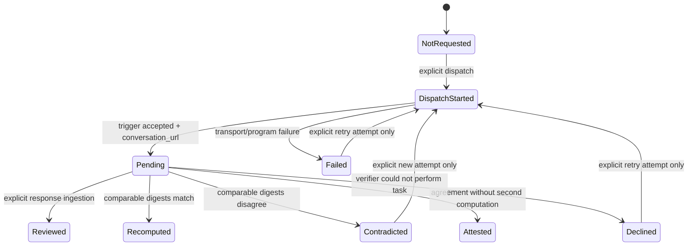
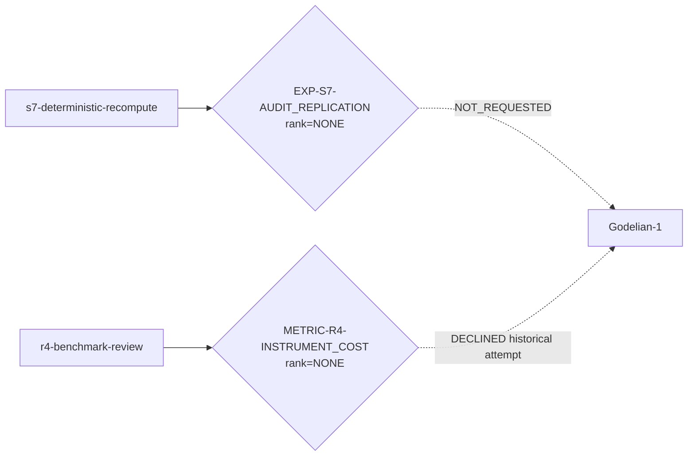

# QΣ-R⁵ — Witness-Weave Scheduler

## Evidence floor

At evidence level **H**, this document specifies a durable asynchronous witness
scheduler.  The state-fold and non-inflation rules are candidates for **P** once
their tests execute.  A Godelian-1 response becomes **M** only when an actual
external run is ingested.  At the time this file was created, no envelope in the
batch was independently witnessed.

The round was preregistered in
[`manifests/qsigma_r5_witness_weave_preregistration.json`](../manifests/qsigma_r5_witness_weave_preregistration.json)
before its implementation.

## Why a weave rather than a queue

A queue asks only which job runs next.  A witness system must also retain:

- which party produced the claim;
- which party reviewed or recomputed it;
- which source and commit were available;
- whether the output was deterministic or environment-dependent;
- which remote conversation carries unfinished state;
- whether two parties actually touched the artifact or merely quoted one
  another;
- whether a contradiction was preserved rather than retried away.

The active object is therefore a **witness nerve**:

- parties are vertices;
- verification acts are directed edges;
- claims index edge families;
- pending conversation URLs are transport handles, not evidence;
- evidence rank is the maximum direct act for one claim, never a sum over paths.

This preserves the theorem already implemented in `aionq.witness_nerve`: an
attestation cycle can reach `ATTESTED` but no number of mutually attesting
parties can manufacture `REVIEWED` or `INDEPENDENT`.

## Russian-doll state, without mystical state inflation

The scheduler has four nested but separately auditable carriers:

```text
Batch manifest
  └─ Task specification
       └─ Attempt
            ├─ append-only transport events
            ├─ remote conversation handle
            └─ evidence-envelope mutation after an explicit response
```

The agent conversation may retain rich working memory.  The repository does not
confuse that memory with durable evidence.  Only the append-only journal and the
claim's `EvidenceEnvelope` determine the reported state.

## State machine



There is intentionally no automatic transition out of `Pending`: the current
workspace-agent interface exposes a trigger and conversation URL, but no
supported verdict-polling endpoint.  The absence of a poller is an honest typed
remainder, not an invitation to invent background execution.

## First batch

[`manifests/godelian_review_batch_v1.json`](../manifests/godelian_review_batch_v1.json)
contains two orthogonal tasks.

| Task | Claim | Requested act | Why |
|---|---|---|---|
| `s7-deterministic-recompute` | `EXP-S7-AUDIT_REPLICATION` | `recomputed` | Octonion counts, CM arithmetic, cohomology ranks and fixed-step Berry output are declared deterministic; digest comparison is meaningful. |
| `r4-benchmark-review` | `METRIC-R4-INSTRUMENT_COST` | `reviewed` | Timings depend on CPU, BLAS and runtime; methodological review is meaningful, cross-machine byte equality is not. |

The tasks are dispatched concurrently, but evidence is never aggregated across
them.  They answer different questions in different fibers.

## Operational commands

The token is read from `GODELIAN_AGENT_TOKEN` or `AGENT_ACCESS_TOKEN`.  Set it in
the shell environment without committing it or placing its value on a command
line.

```bash
# Submit all tasks that have no recorded attempt.
PYTHONPATH=src python3 experiments/dispatch_review_batch.py dispatch

# Fold the append-only journal; this never contacts the agent.
PYTHONPATH=src python3 experiments/dispatch_review_batch.py status

# Produce the current GitHub/Mermaid witness view.
PYTHONPATH=src python3 experiments/dispatch_review_batch.py render

# Apply a terminal JSON response exported from one agent conversation.
PYTHONPATH=src python3 experiments/dispatch_review_batch.py ingest \
  s7-deterministic-recompute response.json

# Retry only after a declined/failed/contradicted attempt, and only explicitly.
PYTHONPATH=src python3 experiments/dispatch_review_batch.py dispatch \
  --retry s7-deterministic-recompute
```

`dispatch` returns after the trigger calls have returned.  A `202`-style
conversation handle is recorded as `PENDING`; the command does not wait for a
future verdict and does not claim that this ChatGPT session will collect it.

## Append-only journal

The default journal is:

```text
artifacts/witness_batches/godelian-review-v1/events.jsonl
```

Each stateful event has:

```text
(batch_id, task_id, claim_id, attempt, ordinal, kind, state, details)
```

The fold orders by `(attempt, ordinal)`, not by file position.  Reordering
independent lines therefore leaves state unchanged.  Conflicting stateful events
at one coordinate are corruption and raise rather than being arbitrarily
resolved.

The critical crash boundary is split in two:

1. `dispatch_started` is written before the request;
2. `transport_returned` is written immediately after a response, before the
   envelope is mutated.

A process that dies after receiving a conversation URL therefore leaves a
handle in the journal.  A process that dies after only `dispatch_started`
produces an uncertain state that is not replayed automatically.  The remaining
unavoidable gap is the instant between remote acceptance and local journal
append; exact-once delivery would require endpoint-supported idempotency keys.

## Current and generated visualization

Before the first live R⁵ dispatch, the source evidence state is:



After dispatch or ingestion, generate rather than hand-edit the live view:

```bash
PYTHONPATH=src python3 experiments/dispatch_review_batch.py render
```

The renderer reads the folded journal and envelopes.  It cannot display a rank
stronger than the direct witness acts support.

## ACAF attack surface

The test suite includes:

- duplicate tasks and repeated dispatcher invocation;
- pending-state inflation;
- line-order perturbation of the journal;
- uncertain crash boundaries;
- exact secret-string search in persisted output;
- explicit versus implicit retry;
- deterministic matching and contradictory recomputation;
- environment-dependent digest mismatch;
- attestation rings from 2 through 64 parties with duplicate edges.

The kill condition remains simple: if pending handles, duplicate tasks, retries,
or circular attestations can increase evidence rank, retire the scheduler as a
ceremonial governance layer.

## Typed remainder

`[R]_operational`: Godelian-1 completion can live in its conversation memory, but
this repository currently has no supported API for retrieving the terminal
response from a conversation URL.  A human or future connector must export the
response JSON and call `ingest`.  That boundary preserves the distinction
between asynchronous execution and falsely promised background work.
